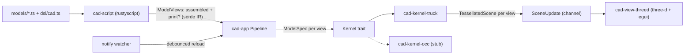

# Architecture

A code-first CAD playground: write a model in TypeScript, see it as a B-rep
solid in a native 3D viewport that hot-reloads on save, and lay it out for
3D printing.

This is a living document. It describes the system as it is now; update it
in the same change as the code. Ideas not yet scheduled live in
[improvements.md](improvements.md).

## Data flow



1. The script host evaluates the model file's default export into
   `ModelViews { assembled, print? }`.
2. The pipeline asks the kernel to build each view into a `TessellatedScene`.
3. A background thread sends `SceneUpdate { views, diagnostics }` over a
   channel; the viewer drains it every frame and swaps GPU meshes.
4. A file watcher re-runs steps 1 to 3 after edits settle.

On any failure the update carries only a diagnostic, and the viewer keeps the
last good meshes.

## Crates

The crates only talk through the IR and two traits, so the script runtime,
kernel and renderer can each be swapped without touching the others.

| Crate | Role |
|---|---|
| `cad-ir` | Serde interchange: `ModelSpec`, `Views<T>`/`ModelViews`, `TessellatedScene`, `Diagnostic`, `Rgb`. No kernel or renderer types. |
| `cad-kernel` | `trait Kernel { fn build(&mut self, &ModelSpec) -> Result<TessellatedScene> }` and `KernelError`. |
| `cad-kernel-truck` | truck B-rep implementation: builds shells, tessellates, emits normals, colors and edges. |
| `cad-kernel-occ` | OpenCascade placeholder that returns `Unsupported`, keeping the slot honest. |
| `cad-script` | `trait ScriptHost` plus the rustyscript implementation and its sandboxed import loader. |
| `cad-view` | `SceneUpdate`, `SceneViews`, `ViewMode`/`ViewSelection` (pure view logic) and `trait ViewportApp`. |
| `cad-view-threed` | three-d window: orbit camera, lighting, edge cylinders, egui overlay. |
| `cad-app` | Binary plus library: CLI, project root discovery, `Pipeline`, watcher. The library half is what the tests drive. |

`dsl/cad.ts` and `models/` are TypeScript, not crates.

## IR

`ModelSpec` is a tree the DSL emits and kernels consume. All lengths are
**millimeters** (what slicers expect), and +Z is up.

| Node | Meaning |
|---|---|
| `Rect { width, height }` | Planar rectangle in XY, corner at the origin. |
| `Extrude { profile, distance }` | Sweeps a 2D profile along +Z into a solid. |
| `Translate { offset, shape }` | Moves a shape. Works on profiles and solids. |
| `Rotate { axis, degrees, origin, shape }` | Rotates about the line through `origin` along `axis` (right-hand rule; the axis is normalized). Works on profiles and solids. |
| `Group { children }` | Shapes shown together. Not a boolean union. |
| `Color { rgb, shape }` | Paints a shape. The innermost color wins; a colored profile colors its extrusion. |
| `Arrange { gap, children }` | Print layout: drops each child onto the plate (z = 0, y = 0) and lines them up along +X. |

`ModelViews` is what a model exports: `assembled` (how it looks put together)
and an optional `print` (parts oriented and arranged for a slicer). A bare
`ModelSpec` export means assembled-only.

`TessellatedScene` holds GPU-ready triangles: positions, normals and sRGB
colors (one per vertex, de-indexed so corners stay crisp), plus indices and an
edge line list taken from the B-rep edges.

### Why a data IR instead of live kernel calls

Scripts return a serde document rather than calling the kernel as they run.

- **Decoupling.** Kernel, runtime and viewer share only the IR, and tests can
  feed IR without V8.
- **Hot reload.** Re-evaluating a pure spec is simpler than resetting kernel
  session state.
- **Sandbox.** The DSL is data constructors only. Scripts get no FS, network
  or FFI.
- **History later.** A spec tree is already a parametric feature tree.

The cost is that scripts can't query geometry (bounding boxes, areas, edge
picks). That's why `Arrange` is a kernel node rather than DSL code. The way
out is a hybrid: keep emitting specs, and add query ops later.

## Script host

- Each eval creates a **fresh rustyscript `Runtime`**. deno caches modules
  by URL, so reusing a runtime would serve stale imports after an edit.
- Imports are resolved and read by a host-side `ImportProvider`. Only
  `file://` paths under the project root are allowed. `http:`, `npm:`,
  `node:` and bare specifiers are rejected.
- The default export (or a `model` export) is read as JSON and parsed by
  shape: `{ kind }` means a bare spec, `{ assembled }` means views. That way
  errors name the bad field.

## App, CLI and hot reload

```
cad-app [MODEL] [--kernel truck|occ]   # MODEL defaults to models/cube.ts; CAD_KERNEL env works too
```

- The model path is resolved against the cwd and must exist, or the app exits
  with code 2 before opening a window.
- The **project root** is the nearest ancestor of the model that contains
  `dsl/cad.ts`, or the model's own folder for a standalone script. It bounds
  what scripts can import.
- **Import-aware watching.** The script host records every file an eval
  reads: the model plus its transitive imports, including ones that failed
  to load. The pipeline keeps this as the model's dependencies. A successful
  eval replaces the set. A failed one adds to it, so fixing a broken import
  still reloads even if the failure stopped later imports from loading.
- After each eval, the watcher re-syncs to the folder of each dependency,
  watched non-recursively. Watching folders rather than files survives
  editors that save by writing a temp file and renaming it over the original.
  For a missing import whose folder doesn't exist yet, the nearest existing
  ancestor is watched recursively.
- Only create, modify or remove events (renames count as modify) for an
  actual dependency start the 150 ms debounce and one re-evaluation. Editing
  another model doesn't reload this one. The watcher thread exits when the
  viewer drops the channel.
- Imports whose bindings are never used are dropped by the TS transpiler and
  never loaded, so they're correctly not dependencies.

## Viewer

- three-d physical material, lit by ambient plus key and fill lights. Vertex
  colors multiply a white albedo; uncolored meshes use `DEFAULT_COLOR`.
- B-rep edges are drawn as instanced thin cylinders, because GL line width
  isn't portable.
- The egui overlay has an **Assembled/Print toggle** (Print is disabled when
  the model has no print view), reload diagnostics and an orbit hint.
- The camera frames the shown view when it first appears and when you switch
  views. Reloads keep your camera.

## Testing

Run `cargo test --workspace`. Verification goes through tests, not by
launching the window:

- **Pure logic is pulled out of GPU and window code** so it can be tested:
  framing, edge transforms, vertex colors, view selection and reframing.
- **The pipeline and watcher run headless** against temp projects with a real
  `notify` watcher. Those tests cover debounce, recovery after errors, DSL
  edits, models outside `models/`, and shutdown.
- **Repo models are smoke-tested:** every file in `models/` must build, and
  any print view must sit on the plate.
- **Model files get shape checks only.** They're edited live, so tests that
  need exact values use inline sources.

## Roadmap

Planned next, roughly in order. Move items into the sections above as they
land.

1. **Named parts.** A `part("name", shape)` node, kept through tessellation,
   so export and UI can address parts.
2. **3MF export.** One object per part with colors, from either view
   (`--export out.3mf`).
3. **Booleans.** Union, difference and intersection via truck-shapeops, so
   colored parts can be real non-overlapping bodies and holes become
   possible.

Out of scope for now: OCC linkage, picking and measurements, constraint
sketching, per-face painting.
