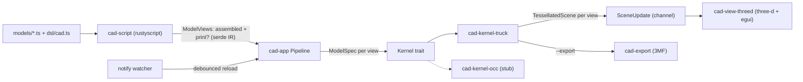

# Architecture

A code-first CAD playground: write a model in TypeScript, see it as a B-rep
solid in a native 3D viewport that hot-reloads on save, and lay it out for
3D printing.

This is a living document. It describes the system as it is now; update it
in the same change as the code. Ideas not yet scheduled live in
[improvements.md](improvements.md).

## Data flow



1. The script host evaluates the model file's default export into
   `ModelViews { assembled, print? }`.
2. The pipeline asks the kernel to build each view into a `TessellatedScene`.
3. A background thread sends `SceneUpdate { views, diagnostics }` over a
   channel; the viewer drains it every frame and swaps GPU meshes.
4. A file watcher re-runs steps 1 to 3 after edits settle.

On any failure the update carries only a diagnostic, and the viewer keeps the
last good meshes.

## Crates

The crates only talk through the IR and two traits, so the script runtime,
kernel and renderer can each be swapped without touching the others.

| Crate | Role |
|---|---|
| `cad-ir` | Serde interchange: `ModelSpec`, `Views<T>`/`ModelViews`, `TessellatedScene`, `Diagnostic`, `Rgb`. No kernel or renderer types. |
| `cad-kernel` | `trait Kernel { fn build(&mut self, &ModelSpec) -> Result<TessellatedScene> }` and `KernelError`. |
| `cad-kernel-truck` | truck B-rep implementation: builds shells, tessellates, emits normals, colors and edges. |
| `cad-kernel-occ` | OpenCascade placeholder that returns `Unsupported`, keeping the slot honest. |
| `cad-script` | `trait ScriptHost` plus the rustyscript implementation and its sandboxed import loader. |
| `cad-view` | `SceneUpdate`, `SceneViews`, `ViewMode`/`ViewSelection` (pure view logic) and `trait ViewportApp`. |
| `cad-view-threed` | three-d window: orbit camera, lighting, edge cylinders, egui overlay. |
| `cad-export` | `TessellatedScene` to 3MF: one watertight object per part, with base-material colors. |
| `cad-app` | Binary plus library: CLI, project root discovery, `Pipeline`, watcher. The library half is what the tests drive. |

`dsl/cad.ts` and `models/` are TypeScript, not crates.

## IR

`ModelSpec` is a tree the DSL emits and kernels consume. All lengths are
**millimeters** (what slicers expect), and +Z is up.

| Node | Meaning |
|---|---|
| `Rect { width, height }` | Planar rectangle in XY, corner at the origin. |
| `Polygon { points }` | Planar simple polygon in XY from its outline. Either winding is normalized to counter-clockwise, and the closing point is implied. Fewer than 3 points, repeated points, self-intersection and zero area are rejected. Non-convex shapes (L, U) tessellate and export correctly. |
| `Extrude { profile, distance }` | Sweeps a 2D profile along +Z into a solid. |
| `Translate { offset, shape }` | Moves a shape. Works on profiles and solids. |
| `Rotate { axis, degrees, origin, shape }` | Rotates about the line through `origin` along `axis` (right-hand rule; the axis is normalized). Works on profiles and solids. |
| `Group { children }` | Shapes shown together. Not a boolean union. |
| `Color { rgb, shape }` | Paints a shape. The innermost color wins; a colored profile colors its extrusion. |
| `Part { name, shape }` | Names a shape as a part, for export and the part list. The innermost name wins; a named profile names its extrusion. |
| `Arrange { gap, children, bed? }` | Print layout: drops each child onto the plate (z = 0), moving it as a unit and never rotating it. Rows wrap at the bed width and spill onto more plates, which sit in a grid, and each plate's parts are centered on it. With no bed, rows wrap into a roughly square block centered on the origin. |

`ModelViews` is what a model exports: `assembled` (how it looks put together)
and an optional `print` (parts oriented and arranged for a slicer). A bare
`ModelSpec` export means assembled-only.

`TessellatedScene` holds GPU-ready triangles: positions, normals and sRGB
colors (one per vertex, de-indexed so corners stay crisp), plus indices and an
edge line list taken from the B-rep edges. `parts` lists named runs as
`ScenePart { name, vertices, indices }`. Each run covers a contiguous range,
and its indices only reference its own vertices, so a part can be cut out as
its own mesh. Consecutive bodies with the same name share one run; a nested
part splits its parent into several runs. `plates` holds the footprints of the
build plates an `Arrange` with a bed used. These are recorded in the
arrange's own frame, so an arrange belongs at the root of a print view, not
inside a transform.

### Why a data IR instead of live kernel calls

Scripts return a serde document rather than calling the kernel as they run.

- **Decoupling.** Kernel, runtime and viewer share only the IR, and tests can
  feed IR without V8.
- **Hot reload.** Re-evaluating a pure spec is simpler than resetting kernel
  session state.
- **Sandbox.** The DSL is data constructors only. Scripts get no FS, network
  or FFI.
- **History later.** A spec tree is already a parametric feature tree.

The cost is that scripts can't query geometry (bounding boxes, areas, edge
picks). That's why `Arrange` is a kernel node rather than DSL code. The way
out is a hybrid: keep emitting specs, and add query ops later.

## Script host

- Each eval creates a **fresh rustyscript `Runtime`**. deno caches modules
  by URL, so reusing a runtime would serve stale imports after an edit.
- Imports are resolved and read by a host-side `ImportProvider`. Only
  `file://` paths under the project root are allowed. `http:`, `npm:`,
  `node:` and bare specifiers are rejected.
- The default export (or a `model` export) is read as JSON and parsed by
  shape: `{ kind }` means a bare spec, `{ assembled }` means views. That way
  errors name the bad field.

## App, CLI and hot reload

```
cad-app [MODEL] [--kernel truck|occ]                         # open the viewer (CAD_KERNEL env works too)
cad-app [MODEL] --export out.3mf [--view auto|print|assembled]  # write a 3MF and exit, no window
```

MODEL defaults to `models/cube.ts`. `--view auto` exports the print layout
when the model has one, and the assembled view otherwise.

- The model path is resolved against the cwd and must exist, or the app exits
  with code 2 before opening a window.
- The **project root** is the nearest ancestor of the model that contains
  `dsl/cad.ts`, or the model's own folder for a standalone script. It bounds
  what scripts can import.
- **Import-aware watching.** The script host records every file an eval
  reads: the model plus its transitive imports, including ones that failed
  to load. The pipeline keeps this as the model's dependencies. A successful
  eval replaces the set. A failed one adds to it, so fixing a broken import
  still reloads even if the failure stopped later imports from loading.
- After each eval, the watcher re-syncs to the folder of each dependency,
  watched non-recursively. Watching folders rather than files survives
  editors that save by writing a temp file and renaming it over the original.
  For a missing import whose folder doesn't exist yet, the nearest existing
  ancestor is watched recursively.
- Only create, modify or remove events (renames count as modify) for an
  actual dependency start the 150 ms debounce and one re-evaluation. Editing
  another model doesn't reload this one. The watcher thread exits when the
  viewer drops the channel.
- Imports whose bindings are never used are dropped by the TS transpiler and
  never loaded, so they're correctly not dependencies.

## Viewer

- three-d physical material, lit by ambient plus key and fill lights. Vertex
  colors multiply a white albedo; uncolored meshes use `DEFAULT_COLOR`.
- B-rep edges are drawn as instanced thin cylinders, because GL line width
  isn't portable. They're a slate color between the background and typical
  face colors, about 0.16% of the model's diagonal wide. Tests pin their
  contrast against both, and their width next to an 18 mm board.
- The egui overlay has an **Assembled/Print toggle** (Print is disabled when
  the model has no print view), a collapsible **part list** for the shown
  view (name and triangle count), reload diagnostics and an orbit hint.
- In Print view, build plates are outlined in blue at z = 0, and framing
  includes them.
- The camera frames the shown view when it first appears and when you switch
  views. Reloads keep your camera. Framing also sets the clip planes from the
  model's size, so anything from a 1 mm part to a 10 m assembly stays visible
  across the whole orbit range. Fixed planes once clipped the 1 m bookshelf
  entirely.

## Printer config

`printer.toml` at the project root holds printer limits (mm):

```toml
[bed]
width = 256
depth = 256
height = 256
```

- **Optional.** Without it, print views pack into a square-ish block with
  no plates.
- **Applied to unset beds.** The pipeline fills it into every `Arrange` in
  the print view that doesn't set its own `bed`. A model's
  `arrange(parts, { bed })` wins.
- **Watched for edits.** It's always one of the model's dependencies, even
  before it exists, so editing or creating it re-lays out the print view
  live.
- **Strictly checked.** Unknown keys, missing fields and non-positive sizes
  are errors that name the file, and the last good meshes stay on screen.
- **Size warnings.** After building, any part bigger than the bed as
  oriented (width, depth or height) produces one warning listing all such
  parts. Without a config, the plate size from an explicit bed is used,
  minus the height check. Warnings keep the meshes, show in amber in the
  overlay, print as `warning:` on the CLI, and are appended to the export
  summary.

## 3MF export

`cad-export` turns one view's `TessellatedScene` into a 3MF package: a zip
holding `[Content_Types].xml`, `_rels/.rels` and `3D/3dmodel.model`.

- **Objects.** There's one object per part name, in first-seen order; a part
  split into several runs becomes one object. Triangles outside any part go
  into a trailing `unnamed` object. Every object is a build item, with no
  transforms, since geometry is already placed. Units are millimeters.
- **Watertight meshes.** The viewer mesh duplicates corner vertices per face
  normal. Export welds vertices by position (1e-5 mm), so a box is 8
  vertices and 12 triangles with manifold edges. Tests check that every edge
  is shared by exactly two triangles in opposite directions, and that signed
  volume is positive (outward normals).
- **Colors.** Distinct colors become one core-spec `basematerials` group with
  `displaycolor`. Each object points at its first triangle's color, and
  triangles with a different color carry `p1`. How a slicer maps these to
  filaments varies.
- `export_3mf` in `cad-app` evaluates, picks the view, writes the file, and
  deletes a partial file on failure.

## Example models

| Model | Shows |
|---|---|
| `models/cube.ts`, `models/square.ts` | The simplest solid and a bare 2D face (assembled-only). |
| `models/bookshelf.ts` | Parameters, named and colored parts, and an assembled vs. flat-packed print view. At 1 m it's deliberately too big to print, so it triggers the bed warning. |
| `models/coasters.ts` | A printable multi-filament set. Each coaster is a base plus a raised stripe inlay (stripes rotated on every other one). The holder is a U-shaped `polygon` extruded into three walls with an open front and no floor (a floor needs booleans). Assembled, the stack sits in the holder; for print, everything is packed and centered on 256 mm plates (two plates by default). It exports as 9 closed objects in 3 colors, or `holder: false` for just the coasters. |

## Testing

Run `cargo test --workspace`. Verification goes through tests, not by
launching the window:

- **Pure logic is pulled out of GPU and window code** so it can be tested:
  framing, edge transforms, vertex colors, view selection and reframing.
- **The pipeline and watcher run headless** against temp projects with a real
  `notify` watcher. Those tests cover debounce, recovery after errors, DSL
  edits, models outside `models/`, and shutdown.
- **Repo models are smoke-tested:** every file in `models/` must build, and
  any print view must sit on the plate.
- **Model files get shape checks only.** They're edited live, so tests that
  need exact values use inline sources.

## Roadmap

Planned next, roughly in order. Move items into the sections above as they
land.

1. **Booleans.** Union, difference and intersection via truck-shapeops, so
   colored parts can be real non-overlapping bodies and holes become
   possible.

Out of scope for now: OCC linkage, picking and measurements, constraint
sketching, per-face painting.
