# Architecture

Plate CAD is a code-first CAD playground: write a model in TypeScript, see it
as a B-rep solid in a native 3D viewport that hot-reloads on save, and lay
it out for 3D printing.

This is a living document. It describes the system as it is now; update it
in the same change as the code. Ideas not yet scheduled live in
[improvements.md](improvements.md).

## Data flow

```mermaid
flowchart LR
  ts["models/*.ts + dsl/cad.ts"] --> script["cad-script (rustyscript)"]
  script -->|"ModelViews: assembled + print? (serde IR)"| pipeline["platecad Pipeline"]
  pipeline -->|"ModelSpec per view"| kernel["Kernel trait"]
  kernel --> occ["cad-kernel-occ (OCCT via cadrum)"]
  occ -->|"TessellatedScene per view"| update["SceneUpdate (channel)"]
  update --> view["cad-view-threed (three-d + egui)"]
  view -->|"ViewerCommand: open folder / model, export, settings"| session["platecad session"]
  session <-->|"settings, last folder"| store["~/.plate/settings.toml"]
  session --> pipeline
  occ -->|"--export, Export 3MF"| export["cad-export (3MF)"]
  watch["notify watcher"] -->|"debounced reload, file list"| session
```



0. The window opens immediately. The session thread (`run_session`) opens
   the folder or model it was started with, announces "Loading model.ts…",
   and hands the build to the model's worker thread, which runs steps 1
   and 2.
1. The script host evaluates the model file's default export into
   `ModelViews { assembled, print? }`.
2. The pipeline asks the kernel to build each view into a `TessellatedScene`.
3. The session sends `SceneUpdate { views, diagnostics }` over a channel
   (wrapped in a `ViewerMessage`); the viewer drains it every frame and
   swaps GPU meshes.
4. A file watcher re-runs steps 1 to 3 after edits settle. The viewer's
   buttons send `ViewerCommand`s back on a second channel.

On any failure the update carries only a diagnostic, and the viewer keeps the
last good meshes.

## Crates

The crates only talk through the IR and two traits, so the script runtime,
kernel and renderer can each be swapped without touching the others.

| Crate | Role |
|---|---|
| `cad-ir` | Serde interchange: `ModelSpec`, `Views<T>`/`ModelViews`, `TessellatedScene`, `MeshQuality`, `Diagnostic`, `Rgb`. No kernel or renderer types. |
| `cad-kernel` | `trait Kernel { fn build_with(&mut self, &ModelSpec, MeshQuality) -> Result<TessellatedScene> }` (plus `build`, at `Fine`), `KernelError`, and logic every kernel shares: `pack` (arrange layout) and `validate_polygon`. |
| `cad-kernel-occ` | The kernel: OpenCascade via cadrum (statically linked OCCT 8.0.1). Builds solids, caches the slow ones, and tessellates them with normals, colors, edges and part ranges. |
| `cad-script` | `trait ScriptHost` plus the rustyscript implementation and its sandboxed import loader. |
| `cad-view` | `SceneUpdate`, `SceneViews`, `ViewMode`/`ViewSelection` (pure view logic), the viewer protocol (`ViewerMessage`, `ViewerCommand`, `FolderListing`) and `trait ViewportApp`. |
| `cad-view-threed` | three-d window: orbit camera, lighting, edge cylinders, egui overlay. |
| `cad-export` | `TessellatedScene` to 3MF: one watertight object per part, with base-material colors. |
| `platecad` | The `plate` binary plus library: CLI, project root discovery, `Pipeline`, the viewer session (commands, folder listing, watcher, export). The library half is what the tests drive. |

`dsl/cad.ts` and `models/` are TypeScript, not crates.

## IR

`ModelSpec` is a tree the DSL emits and the kernel consumes. All lengths are
**millimeters** (what slicers expect), and +Z is up.

| Node | Meaning |
|---|---|
| `Rect { width, height }` | Planar rectangle in XY, corner at the origin. |
| `Circle { radius }` | Planar circle in XY, centered on the origin. It extrudes into a cylinder with smooth side normals. |
| `RoundedRect { width, height, radius }` | A `Rect` (corner at the origin) with its corners rounded by true arcs, so extruding it needs no `\|Z` fillet. `radius` is at most half the shorter side (`validate_primitive`); at exactly half, the sides it uses up are left out, so the ends are fully round. The DSL's `slot({ length, width, at })` is one of those, centered with a `Translate`. |
| `Cutout { outer, holes }` | A profile with holes (coplanar profiles, holes inside the outline). Hole wires are oriented against the outline using a Newell normal. No boolean is involved, so lined-up faces never fail. |
| `Polygon { points }` | Planar simple polygon in XY from its outline. Either winding is normalized to counter-clockwise, and the closing point is implied. Fewer than 3 points, repeated points, self-intersection and zero area are rejected. Non-convex shapes (L, U) tessellate and export correctly. |
| `Extrude { profile, distance, direction? }` | Sweeps a 2D profile `distance` mm along `direction` (normalized, default +Z) into a solid. The face is flipped to point along the sweep (every profile is wound counter-clockwise about +Z), so solids are never inside-out. A direction lying in the profile's plane is an error. |
| `Revolve { profile, degrees }` | Lathe: the profile is drawn in XY with X as the radius and Y as the height, stood up into XZ, and spun around +Z (default 360°). It must stay at x >= 0; touching the axis is fine (a solid knob). |
| `Sphere { radius }`, `Cylinder { radius, height }`, `Cone { radius, top, height }`, `Torus { radius, tube }` | Primitive solids. A sphere and torus are centered on the origin (the torus lies flat around +Z); a cylinder and cone stand on the XY plane with their base centered on it. A cone narrows from `radius` to `top` (either may be 0, not both); a torus needs `tube < radius`. Sizes are checked by `validate_primitive` in `cad-kernel`. They're analytic surfaces (one smooth face each), which keeps booleans cheap: a revolved polygon has a face per segment. The DSL's `at` option wraps them in a `Translate`. |
| `Translate { offset, shape }` | Moves a shape. Works on profiles and solids. |
| `Rotate { axis, degrees, origin, shape }` | Rotates about the line through `origin` along `axis` (right-hand rule; the axis is normalized). Works on profiles and solids. |
| `Group { children }` | Shapes shown together. Not a boolean union. |
| `Union { children }`, `Difference { shape, tools }`, `Intersect { children }` | Booleans on closed solids, one OCC `BOPAlgo_CellsBuilder` pass per node. Faces that line up exactly (shared planes, solids that only touch, cutters ending flush) work. The result keeps the first operand's color and part name. |
| `Fillet { shape, radius, edges }`, `Chamfer { shape, distance, edges }` | Round or bevel the selected edges of each solid. `edges` are CadQuery-style selectors, unioned; empty means all. `\|X/\|Y/\|Z` picks straight edges parallel to an axis. `>Z/<Z` (and X, Y) picks edges lying at the solid's max/min, measured from its sampled edges because OCC's bounding box is padded. |
| `Color { rgb, shape }` | Paints a shape. The innermost color wins; a colored profile colors its extrusion. |
| `Part { name, shape }` | Names a shape as a part, for export and the part list. The innermost name wins; a named profile names its extrusion. |
| `Arrange { gap, children, bed? }` | Print layout: drops each child onto the plate (z = 0), moving it as a unit and never rotating it. Rows wrap at the bed width and spill onto more plates, which sit in a grid, and each plate's parts are centered on it. With no bed, rows wrap into a roughly square block centered on the origin. |

`ModelViews` is what a model exports: `assembled` (how it looks put together)
and an optional `print` (parts oriented and arranged for a slicer). A bare
`ModelSpec` export means assembled-only.

### Bare 2D profiles

OCC meshes solids, not lone faces, so a profile shown on its own (not
extruded or revolved, like `models/square.ts`) is built as a plate
`FLAT_THICKNESS` (0.01 mm) thick, keeping its color and part name. It
exports as that plate too. This applies wherever a profile appears outside
a sweep, so a forgotten `extrude` inside a boolean also gives a thin plate
rather than an error.

### Curved edges and bounds

Edges are sampled at the Fine tolerance for the viewer's edge lines and for
edge selection. `arrange` needs tight bounds to drop parts onto the plate,
and OCC's own bounding box is padded by tolerances and loose around curved
faces (it floated the cat's print view). So `arrange` measures each child
from the vertices of a Fine mesh of a deep copy (the copy keeps the
triangulation off the real solid, which a later coarser mesh would
otherwise reuse). Mesh vertices lie on the surface, so those bounds are
exact on planar faces and edges, and within 0.01 mm of curved extremes.
Mesh bounds of curved shapes are inscribed polygons, so tests compare them
with that tolerance.

### Mesh quality

`MeshQuality` sets how far a mesh may stray from the true surface: **Draft**
0.1 mm, **Normal** 0.03 mm, **Fine** 0.01 mm (all with a 0.5 rad angular
limit). The kernel takes it in `build_with`, and `build` means Fine, so
tests and the CLI keep their old meshes. Only the triangles depend on it.
Edge selection (edge samples) and bounds for `arrange` (a fine mesh) always
use Fine, so `fillet(..., { edges })` and print
layouts don't change with quality. Halving the tolerance roughly doubles
segments around a circle, and quadruples triangles on doubly curved
surfaces like fillets. On `playing.ts` (two filleted cups on a filleted
plate, debug build) an assembled export takes 1.0 s at Draft, 1.2 s at
Normal and 2.2 s at Fine; the rest is script, booleans and fillets.

`TessellatedScene` holds GPU-ready triangles: positions, normals and sRGB
colors (one per vertex, de-indexed so corners stay crisp), plus indices and an
edge line list taken from the B-rep edges. `parts` lists named runs as
`ScenePart { name, vertices, indices }`. Each run covers a contiguous range,
and its indices only reference its own vertices, so a part can be cut out as
its own mesh. Consecutive bodies with the same name share one run; a nested
part splits its parent into several runs. `plates` holds the footprints of the
build plates an `Arrange` with a bed used. These are recorded in the
arrange's own frame, so an arrange belongs at the root of a print view, not
inside a transform.

### Why a data IR instead of live kernel calls

Scripts return a serde document rather than calling the kernel as they run.

- **Decoupling.** Kernel, runtime and viewer share only the IR, and tests can
  feed IR without V8.
- **Hot reload.** Re-evaluating a pure spec is simpler than resetting kernel
  session state.
- **Sandbox.** The DSL is data constructors only. Scripts get no FS, network
  or FFI.
- **History later.** A spec tree is already a parametric feature tree.

The cost is that scripts can't see geometry while they build the tree. The
way out is a hybrid: scripts still emit specs, and can ask the kernel about
a subtree mid-eval (see "Geometry queries" under Script host). Only
`bounds` exists so far. `Arrange` stays a kernel node: it predates queries,
and keeping it in the kernel lets it reuse the cache.

## Kernel

There's one kernel, OpenCascade through cadrum, behind the `Kernel` trait
in `cad-kernel` so the rest of the app only sees the IR. (An earlier
pure-Rust kernel, truck, was dropped: its booleans failed on lined-up faces
and curved solids, and it couldn't fillet.)
`crates/cad-kernel-occ/tests/geometry.rs` checks it against exact values:
volumes (0.5%), bounds (0.05 mm), part names, colors and plates, with every
exported object closed.

| | |
|---|---|
| Booleans with lined-up faces | Work (shared planes, touching solids, flush cutters) |
| Desk organizer export (debug) | ~0.4 s |
| Coaster set export (debug) | ~0.3 s |
| Bare 2D profile shown on its own | A 0.01 mm plate (see "Bare 2D profiles") |
| Fillets, chamfers | Yes, with edge selectors |
| Loft, sweep, shell, STEP | Available in cadrum, not exposed yet |
| Build | Links a 118 MB prebuilt static OCCT; see below |
| Solid cache | Yes; see below |

**Solid cache.** The slow steps are booleans, fillets and chamfers. One
`CellsBuilder` pass intersects every face of every operand, so its cost grows
with face count. `OccKernel` therefore keeps the solids each of those nodes
built, keyed by the subtree's debug text alone. Entries are stored
unstyled (built with no inherited color or part name), and a hit fills in
whatever the caller inherits for each body that didn't set its own. The
innermost `Color`/`Part` always wins, so that matches building it styled.
Hits come from four places:

- Within a build: the same subtree twice, even under different colors or
  part names.
- From a script's `bounds` query: it measures the bare shape during the
  eval, and the build hits it even after the model wraps it in `part`.
- Across the two views: a print view that `arrange`s the assembled parts
  hits the solids the assembled build just made, since only the outer
  transform differs.
- Across reloads: only subtrees whose spec text changed are rebuilt.

Solids don't depend on mesh quality, so a quality change or a Fine export
rebuild only re-meshes. A hit returns deep copies (cheap next to a boolean).
Entries unused for 4 builds (two reloads) are dropped. Subtrees containing
an `Arrange` are never cached, because a hit would skip recording plates.
The tight bounds `arrange` measures for each child (see "Curved edges and
bounds") are cached the same way.

On `cat.ts` (a fused union of many curved solids, debug build), caching
takes an export from 21.9 s to 11.8 s, because the print view reuses the
assembled fur.

**Building with OCC.** cadrum's build script downloads a prebuilt static
OCCT from the cadrum author's GitHub releases (a third-party binary, not
Open Cascade's own) and caches it under `target/`. Its HTTP client fails on
GitHub's redirect ("headers' total size surpassed max_headers_size"). The
workaround is to fetch the same asset with curl and point the build at it
once; after that the cache is used until `cargo clean`:

```sh
curl -fL -o occt.tar.gz https://github.com/lzpel/cadrum/releases/download/occt-8_0_1_rev3/occt-8_0_1_rev3-x86_64_pc_windows_msvc.tar.gz
CADRUM_PREBUILT_URL=file:///absolute/path/to/occt.tar.gz cargo build
```

cadrum's `source` feature builds Open Cascade's own sources instead (needs
CMake, 10 to 30 minutes). OCCT is LGPL-2.1, linked statically: fine for
local use, but distributing the binary carries relinking obligations.

## Script host

- Each eval creates a **fresh rustyscript `Runtime`**. deno caches modules
  by URL, so reusing a runtime would serve stale imports after an edit.
- Imports are resolved and read by a host-side `ImportProvider`. Only
  `file://` paths under the project root are allowed. `http:`, `npm:`,
  `node:` and bare specifiers are rejected.
- Imports resolve TypeScript style, so `.ts` is optional. An existing file
  always wins; otherwise `./parts` means `parts.ts` or `parts/index.ts`,
  and `./parts.js` means `parts.ts` (as NodeNext projects write it).
  `resolve` returns the rewritten `.ts` URL, since rustyscript picks the
  transpiler by the URL's extension. A missing import resolves to its `.ts`
  name, so the error and the watched dependency name the file to create.
- The default export (or a `model` export) is read as JSON and parsed by
  shape: `{ kind }` means a bare spec, `{ assembled }` means views. That way
  errors name the bad field.
- **Evals time out** after 10 s (`DEFAULT_TIMEOUT`, or
  `RustyScriptHost::with_timeout`). rustyscript's own `timeout` only
  interrupts awaits, so a watchdog thread calls V8's `terminate_execution`
  on the isolate, which stops synchronous loops too, at the top level or in
  the export. The eval fails with `ScriptError::Timeout`; the next eval gets
  a fresh runtime as usual.
- **Geometry queries.** The DSL's `bounds(shape)` returns `{ min, max,
  size, center }` while the script runs, so models can fit parts to what
  the kernel actually built. It calls `rustyscript.functions.plate_bounds`,
  a Rust function the host registers on each runtime. That forwards to a
  `GeometryQueries` trait object (`cad-script`); `platecad` implements it
  with the pipeline's own kernel (`Kernel::bounds`), shared through an
  `Arc<Mutex<..>>` because the eval and the build never overlap. The
  kernel measures with the same tight bounds as `arrange`, and doesn't
  call `end_build`, so the solids a query builds are cache hits in the
  build right after. Kernel errors come back as script exceptions prefixed
  `bounds:`. The watchdog is paused during a query, so a slow boolean
  doesn't count toward the eval timeout. A host without queries still
  registers the function, which throws "bounds needs a kernel", because
  rustyscript's `functions` proxy returns a function for any name.
- **Pipelines are DSL sugar.** `pipeline(shape, ...steps)` threads a shape
  through `(shape) => shape` functions, so `fillet(extrude(rect(...)))`
  reads top to bottom. `step.*` (`extrude`, `revolve`, `translate`,
  `rotate`, `fillet`, `chamfer`, `cut`, `add`, `intersect`, `color`, `part`)
  are the ops with the shape argument removed. They emit the same specs as
  the nested calls, so the IR and kernel don't know pipelines exist.

## App, CLI and hot reload

Plate CAD's command is `plate` (the crate and repo are `platecad`). Run it from
the repo with `cargo run -p platecad -- …`, or install it with
`cargo install --path crates/platecad`.

```
plate [open] [PATH]                                             # open the viewer
plate export MODEL [-o FILE.3mf] [--view auto|print|assembled] [--quality draft|normal|fine]  # write a 3MF and exit (default fine)
plate init [DIR]                                                # set up a new project (default: the cwd)
```

`open` is the default subcommand, so `plate models/x.ts` works. PATH is a
model file or a folder. A model opens with its project root in
the file list; a folder opens with no model picked. Without PATH, the cwd
is opened if it's a project root. Otherwise the last opened folder is
reopened if it still exists (see Settings), and failing that the viewer
starts empty.
`--view auto` exports the print layout when the model has one, and the
assembled view otherwise. Without `-o`, export writes
`<project root>/outputs/<model>_<view>.3mf`, the same place as the viewer's
Export button.

- The path is resolved against the cwd and must exist, or the app exits
  with code 2 before opening a window.
- The **project root** is the nearest ancestor of the model that contains
  `dsl/cad.ts`, or the model's own folder for a standalone script. For an
  opened folder it's the folder or its nearest such ancestor, or else the
  folder itself (`folder_root`). It bounds what scripts can import, and
  viewer exports go under it.
- **Import-aware watching.** The script host records every file an eval
  reads: the model plus its transitive imports, including ones that failed
  to load. The pipeline keeps this as the model's dependencies. A successful
  eval replaces the set. A failed one adds to it, so fixing a broken import
  still reloads even if the failure stopped later imports from loading.
- After each eval, the watcher re-syncs to the folder of each dependency,
  watched non-recursively. Watching folders rather than files survives
  editors that save by writing a temp file and renaming it over the original.
  For a missing import whose folder doesn't exist yet, the nearest existing
  ancestor is watched recursively.
- Only create, modify or remove events (renames count as modify) for an
  actual dependency start the 150 ms debounce and one re-evaluation. Editing
  another model doesn't reload this one. The watcher thread exits when the
  viewer drops the channel.
- Imports whose bindings are never used are dropped by the TS transpiler and
  never loaded, so they're correctly not dependencies.

### Session

`run_session` is the app side of the viewer. One thread handles commands,
file events and build results from a single input channel, so a command
that arrives during a debounce waits its turn instead of being lost.

- **Builds run on a worker.** Each open model gets a thread
  (`spawn_worker`) that owns its `Pipeline` and runs jobs: evaluations, and
  export re-meshes. The session never blocks on a build, so picking another
  model, changing settings or opening a folder answers at once. Results come
  back as `Input::Built`, tagged with the model's id and the evaluation's
  sequence number. The session drops results for a model that's been closed,
  and evaluations older than the newest one asked for. Back-to-back
  evaluations waiting in a worker's queue collapse into the last one. A
  build already running can't be stopped (OpenCascade has no cancel), so a
  superseded or closed model's build finishes in the background, using a
  core, before its result is dropped. Closing a model drops its job sender,
  which ends the worker after that. A panic inside a job becomes an error
  diagnostic rather than a viewer stuck on "Loading…".
- **Dependencies for the watcher** are copied from each finished evaluation.
  Until the first one finishes they're just the model file, so saving it
  mid-build still queues a rebuild.

- **Opened folder.** It's watched recursively (dependency folders inside it
  need no watch of their own). Only creates, removes and renames under it
  re-list it, and the viewer hears about it only if the listing changed.
  Content edits never re-list.
- **Targeted reloads.** Events reload the open model only if they touch one
  of its dependencies, which may lie outside the folder (opening `models/`
  still watches `dsl/cad.ts`). Other models in the folder are never built
  until picked.
- **Opening a model** outside the opened folder opens its project root
  first. Each opened model gets a fresh `Pipeline` rooted at the folder's
  project root, and its own worker.
- **Export** writes the last good build of the view on screen to
  `<root>/outputs/<model>_<view>.3mf` (`export_path`), creating `outputs/`.
  After a failed rebuild that's still what the viewer shows. It's written
  at the export quality: if the screen shows another quality, the worker
  meshes the last good specs again (`Pipeline::rebuild`, no script run),
  after an "Exporting model.ts with a fine mesh…" notice. It queues behind
  any build in progress, so it exports that build. The result (or why
  there's nothing to export) comes back as a `ViewerMessage::Notice`.
- **Settings.** `ViewerCommand::Settings` saves the new settings and, if the
  view quality changed, rebuilds the open model at it. Every evaluation job
  carries the view quality.
- The session stops when the viewer drops either channel end.

### Settings

`Store` keeps an `AppState` in `~/.plate/settings.toml` (`$PLATE_HOME`
overrides the folder; on Windows `~` is `%USERPROFILE%`):

```toml
last_folder = "C:\\Users\\me\\models"

[settings]
view_quality = "normal"   # draft | normal | fine: the meshes on screen
export_quality = "fine"   # Export 3MF in the viewer
show_edges = true
antialiasing = true       # 4x MSAA; read when the window opens
```

- `plate` reads it at startup and sends `ViewerMessage::Settings` first, so
  the window opens with the right multisampling. The session saves it when
  settings change and whenever another folder is opened.
- Missing keys take their defaults, so older files keep loading. An
  unreadable or malformed file gives the defaults plus a warning (stderr and
  the overlay), and the next save replaces it.
- `plate export` doesn't read it; it takes `--quality` (default fine), so
  scripted exports don't depend on viewer settings. Tests use
  `Store::default()`, which never touches the disk.

### New projects

`plate init DIR`, or the viewer's "New project…" button, writes a project
that opens, builds and exports as is:

| File | Contents |
|---|---|
| `dsl/cad.ts` | The DSL built into the binary (`include_str!` of the repo's `dsl/cad.ts`). It also marks the project root. |
| `printer.toml` | A Bambu Lab P2S bed, 256 × 256 × 256 mm. |
| `models/cube.ts` | A 20 mm cube. |
| `tsconfig.json` | Lets editors resolve the `.ts` import extensions and type-check models against the DSL (strict). The app doesn't read it. |
| `.gitignore` | `/outputs`. |

It creates DIR if needed, and refuses (writing nothing) if any of those
files exists; other files are fine. A project keeps the DSL it was created
with, so upgrading Plate CAD doesn't change an existing project's DSL.
Building the DSL into the binary means `cargo install --path crates/platecad`
works, but the crate can't be published to crates.io as is (the file lives
outside the crate).

## Viewer

- **Icon.** `assets/make_icon.py` draws `assets/plate.ico`, a cube on a print
  bed. It's dependency-free Python that rasterizes each size from 16 to 256 px
  with 4x4 supersampling and stores PNG entries. The `platecad` crate's
  `build.rs` (via `winresource`) embeds it in `plate.exe` as icon resource 1,
  with product name, description and copyright, on Windows targets only. Explorer
  shows that icon. The window doesn't pick it up by itself, so the viewer
  builds its winit window itself (three-d's `WindowSettings` has no icon) and
  loads resource 1 for the title bar and taskbar. Without the resource (test
  binaries) the window keeps the default icon. `tests/icon.rs` checks the
  sizes and that the exe contains every image.
- three-d physical material, lit by ambient plus key and fill lights. Vertex
  colors multiply a white albedo; uncolored meshes use `DEFAULT_COLOR`.
- B-rep edges are drawn as instanced thin cylinders, because GL line width
  isn't portable. They're a slate color between the background and typical
  face colors, about 0.16% of the model's diagonal wide. Tests pin their
  contrast against both, and their width next to an 18 mm board.
- **Loading state.** Before every evaluation (the first and each rebuild)
  the reload thread sends a `SceneUpdate::loading` message. The overlay
  shows a spinner and "Loading model.ts… 2.3 s" until the result arrives,
  keeping the current meshes. A slow or stuck build shows as a timer that
  keeps counting, never as a missing window.
- A left **Files panel** has a "New project…" button (pick or create an
  empty folder; the session runs `init_project` there, then opens it on
  `models/cube.ts`, or explains why not, without writing anything, if the
  folder already has any starter file), an "Open folder…" button (the native picker
  via `rfd`, run on its own thread so the window keeps drawing) and the
  folder's tree: folders that contain `.ts` files, at any depth, then `.ts`
  files (not `.d.ts`), each sorted case-insensitively. Clicking a file opens
  it, and the open model is highlighted with its folders expanded. Nothing
  is skipped by name; empty folders just don't show.
- The 3D view is drawn in the part of the window right of the panel
  (`scene_viewport`), so models center in what's visible and the panel
  can be resized without covering them.
- Switching models drops the old meshes, diagnostics and notice, and frames
  the camera on the new model when it arrives.
- The egui overlay has an **Export 3MF** button for the view on screen
  (see Session), with the outcome shown under it, an **Assembled/Print toggle** (Print is disabled when
  the model has no print view), a collapsible **part list** for the shown
  view (name and triangle count), reload diagnostics and an orbit hint.
- A **⚙** next to the view toggle opens the settings window: mesh quality
  on screen and for export (Draft/Normal/Fine), show edges, and antialiasing
  (applies the next time the window opens). Each change goes to the session
  as `ViewerCommand::Settings` to be saved; edges toggle at once.
- **Redraw on demand.** The render loop sleeps until something happens
  (`wait_next_event`). Input events wake it. So do app messages: a thread
  forwards the session's channel and wakes the loop with an
  `EventLoopProxy` event per message (`forward_waking`), and once more when
  the channel closes. The folder picker wakes it when it closes. While a
  build runs (its timer ticks) or egui wants a repaint, it keeps drawing
  (`keep_drawing`). Before this it redrew every frame, keeping laptop GPUs
  busy with a still model.
- In Print view, build plates are outlined in blue at z = 0, and framing
  includes them.
- The camera frames the shown view when it first appears and when you switch
  views. Reloads keep your camera. Framing also sets the clip planes from the
  model's size, so anything from a 1 mm part to a 10 m assembly stays visible
  across the whole orbit range. Fixed planes once clipped the 1 m bookshelf
  entirely.

## Printer config

`printer.toml` at the project root holds printer limits (mm):

```toml
[bed]
width = 256
depth = 256
height = 256
```

- **Optional.** Without it, print views pack into a square-ish block with
  no plates.
- **Applied to unset beds.** The pipeline fills it into every `Arrange` in
  the print view that doesn't set its own `bed`. A model's
  `arrange(parts, { bed })` wins.
- **Watched for edits.** It's always one of the model's dependencies, even
  before it exists, so editing or creating it re-lays out the print view
  live.
- **Strictly checked.** Unknown keys, missing fields and non-positive sizes
  are errors that name the file, and the last good meshes stay on screen.
- **Size warnings.** After building, any part bigger than the bed as
  oriented (width, depth or height) produces one warning listing all such
  parts. Without a config, the plate size from an explicit bed is used,
  minus the height check. Warnings keep the meshes, show in amber in the
  overlay, print as `warning:` on the CLI, and are appended to the export
  summary.

## 3MF export

`cad-export` turns one view's `TessellatedScene` into a 3MF package: a zip
holding `[Content_Types].xml`, `_rels/.rels` and `3D/3dmodel.model`.

- **Objects.** There's one object per part name, in first-seen order; a part
  split into several runs becomes one object. Triangles outside any part go
  into a trailing `unnamed` object. Every object is a build item, with no
  transforms, since geometry is already placed. Units are millimeters.
- **Watertight meshes.** The viewer mesh duplicates corner vertices per face
  normal. Export welds vertices within 1e-5 mm, so a box is 8 vertices and
  12 triangles with manifold edges. The weld checks neighbouring grid cells,
  not just rounded keys: boolean output computes shared points twice with
  float noise, and plain rounding split such pairs across a cell boundary,
  leaving cracks. Tests check that every edge
  is shared by exactly two triangles in opposite directions, and that signed
  volume is positive (outward normals).
- **Colors.** Distinct colors become one core-spec `basematerials` group with
  `displaycolor`. Each object points at its first triangle's color, and
  triangles with a different color carry `p1`. How a slicer maps these to
  filaments varies.
- `export_3mf` in `platecad` evaluates, picks the view, writes the file, and
  deletes a partial file on failure.

## Example models

| Model | Shows |
|---|---|
| `models/cube.ts`, `models/square.ts` | The simplest solid and a bare 2D face (assembled-only). |
| `models/bookshelf.ts` | Parameters, named and colored parts, and an assembled vs. flat-packed print view. At 1 m it's deliberately too big to print, so it triggers the bed warning. |
| `models/rounded_box.ts` | An open-top box with rounded vertical corners and even walls and floor (`roundedBox()` defaults: 60 × 40 × 30 mm, 3 mm walls; the file's default export may override them): a `|Z`-filleted block minus a cavity filleted with the outer radius minus the wall, which overshoots the top. |
| `models/desk_organizer.ts` | Shows the newer modeling features in one printable set: a pen cup (a `polygon` wall-plus-floor section, `revolve`d), a card holder (a base `union`ed with a back rest made by a slanted `extrude`, then card slots cut with a `difference` of slanted cutters), and a base plate (a `cutout` with `circle` holes for 10 mm magnets). Fillets round the plate's and holder's vertical corners, and a 0.8 mm chamfer on the cup's bottom edge stops the first layer flaring. It prints as three closed parts on one 256 mm plate. |
| `models/coasters.ts` | A printable multi-filament set. Each coaster is a base plus a raised stripe inlay (stripes rotated on every other one). The holder is a tray with a floor and three walls, open at the front: a box minus an overshooting cutter. Assembled, the stack sits in the holder; for print, everything is packed and centered on 256 mm plates (two plates by default). It exports as 9 closed objects in 3 colors, or `holder: false` for just the coasters. |
| `models/cat.ts` | A stress test: a sitting cat. The fur is one `union` of a revolved egg body, `sphere` head, haunches and paws, `cone` ears, `cylinder` legs and a curled tail, trimmed flat at z = 0. Eyes, pupils, muzzle, nose, whiskers, a `torus` collar and a bell are separate colored parts. Its print view repeats the assembled cat, which the solid cache serves. Debug export: 6.6 s at Draft, 10.2 s at Fine, about 2 s of which is the fine mesh `arrange` measures it with (reloads in the viewer take that from the cache). Before the cache and true spheres, when its spheres were 24-band revolved polygons, it took 21.9 s. |

## Testing

Run `cargo test --workspace`. Verification goes through tests, not by
launching the window:

- **Pure logic is pulled out of GPU and window code** so it can be tested:
  framing, edge transforms, vertex colors, view selection and reframing.
- **The pipeline and watcher run headless** against temp projects with a real
  `notify` watcher. Those tests cover debounce, recovery after errors, DSL
  edits, models outside `models/`, and shutdown.
- **Repo models are smoke-tested:** every file in `models/` must build into
  closed, outward-facing solids, and any print view must sit on the plate.
- **Model files get shape checks only.** They're edited live, so tests that
  need exact values use inline sources.

## Roadmap

Planned next, roughly in order. Move items into the sections above as they
land.

Nothing scheduled right now; pick from improvements.md.

Out of scope for now: picking and measurements, constraint sketching,
per-face painting.
